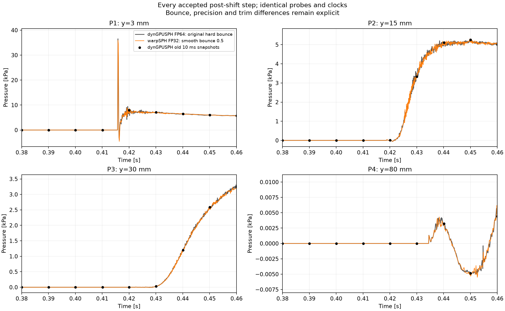

# dynGPUSPH every-step accepted pressure: first-impact comparison

**Scope clarification (user, 2026-10-29):** the question about much larger
ringing concerns the late long-run oscillations, especially1.25–1.65s.
This0.460s replay does **not** address those. The current repaired solver has
not been evolved into that interval, no matching dense accepted-state
dynGPUSPH trace exists there, and the earlier late FP64 campaign was cancelled.
The late-amplitude discrepancy remains unresolved; first-impact agreement
must not be generalized to it. No additional physical run starts from this
clarification alone.

The requested original-IC dynGPUSPH rerun is complete: **2113 steps to
0.46004971449390497 s**, 1821.949 s wall / **862.257 ms per step**. Every
timestep and accumulated clock equals the original reference exactly. This
resolves the narrow first pulse that its old 10 ms snapshots missed.

## Matched controls and remaining differences

- Original Lobovsky preset: 320000 fluid and 32176 sampled static wall rows,
  dx=0.00075 m, support=0.003 m, rho=1000 kg/m³, fluid mass=180 kg/m.
  All six supplied preset-file hashes match the previous reference. Only the
  bounded terminal time and step limit change. Native timestep selection is
  unchanged; warpSPH replays that same sequence.
- Both pressure estimators use fluid-only normalized Wendland C2 at x=1.61 m,
  y=3/15/30/80 mm, every **accepted post-shift** physical step. A dry probe is
  explicitly zero. Native weight and contributing fluid count are retained.
  The original earlier-RK `probe.plt` is not substituted for this observation.
- dynGPUSPH uses FP64 and its original hard, lagged wall bounce and original
  pressure-trim indexing. Repaired warpSPH uses FP32, smooth fresh-stage
  bounce ramp0.5 and physical-fluid-ID trim. These remain named differences;
  this run does not isolate precision, bounce or trim as a cause.

## Actual pressure comparison

| P1 measurement | dynGPUSPH FP64 | Repaired warpSPH FP32 |
|---|---:|---:|
| First maximum |36.530 kPa|35.916 kPa|
| Maximum time |0.415868396 s|0.415868396 s|
| Immediate minimum |−3.923 kPa|−4.547 kPa|
| Minimum time |0.416356387 s|0.416356387 s|

The repaired peak is 1.68% below dynGPUSPH. Both large first-pulse extrema
occur at identical recorded clocks. dynGPUSPH also rings after the pulse;
the old smooth-looking grey curve was undersampled. Its largest saved P1
value in this window was only 7.959 kPa at 0.420056 s.

At the first native P1 maximum the probe has **two fluid contributors** and
an unnormalized weight sum of **0.0006602672**. This is also its first wet
sample. At the negative rebound it has seven contributors and weight0.95759.
Keep this support information when interpreting the normalized point probe;
neither reference agreement nor this pressure maximum establishes physical
wall-pressure accuracy.

Comparing both warpSPH implementations to the **dense** reference over
0.38–0.46 s changes the earlier assessment:

| Probe | Previous warpSPH + source shift RMSE | Repaired reference-solver warpSPH RMSE | Reduction |
|---|---:|---:|---:|
| P1 |2619.982 Pa|522.388 Pa|80.06%|
| P2 |134.034 Pa|98.141 Pa|26.78%|
| P3 |38.064 Pa|27.830 Pa|26.88%|
| P4 |1.926 Pa|0.275 Pa|85.70%|

These values include dry samples and impact timing. P1 RMSE restricted to
samples wet in both repaired warpSPH and dynGPUSPH is643.116 Pa. Its
0.418–0.46 s post-peak RMSE is550.116 Pa, with remaining oscillation/phase
differences. The earlier sparse-clock P1 comparison remains a historical
measurement, but its apparent worsening did not describe the full trace.

[Pulse detail](figures/dyngpusph-dense-first-pulse-2026-10-29.png).
The spike and ringing are present in FP64 dynGPUSPH; they are not unique to
the FP32 warpSPH run. No precision-only attribution or default promotion
follows from this comparison. No additional physical run is queued.

## Qualification and retained evidence

The read-only observer is generated by
`scripts/acsph_reference/observe_accepted.py` into an isolated qualified build.
It writes no simulator array. Observation-on/off three-step x/v/p/rho/volume/
boundary fields and clock are bitwise identical. Across the full rerun all
48 output frames (47 unique clocks, one terminal duplicate) match the original
dynGPUSPH fields bitwise. The every-step GPU probes match the independent
snapshot estimator to **1.82e-12 Pa** on saved frames. These checks establish
observation parity, not equality between the two solvers.

All saved fields are finite, membership and mass are constant, static wall
coordinates are bitwise fixed and wall velocity is zero. Native video decodes
48 frames. Source and binary hashes remain unchanged. There are17 startup
200-iteration caps, as in the original reference; none after startup. The
GPU was uncontended in the recorded occupancy checks. The original full run
was contended and is not an isolated performance control. Current warpSPH's
same-length replay cost1194.077 s /565.110 ms per step, with different precision,
bounce, trim and video cadence; this is not a controlled speedup claim.

Root: `.tmp/acsph-dense-reference-2026-10-29/`:

- `qualified/`: source patch, build recipe, source/binary hashes and build log.
- `campaign-status.json`, `matching-controls.json`, `validation-receipt.json`:
  noninterference, clock, probe and physical-state checks.
- `dyngpusph-f64-dense/accepted-probes.csv`: 2114 rows including initial state;
  t, P1–P4, weights and neighbour counts. Inputs, raw logs, result, snapshots
  and video are alongside it.
- `analysis/summary.json`: all extrema, clock comparison, wet support,
  old/repaired RMSE and plotted traces. Analysis scripts/hashes are retained
  separately from the numerical sources. Initial analysis is retained too.
- `dynGPUSPH-lobovsky-dense-first-impact.h5`: viewer trajectory with47 unique
  states plus every-step pressure/weight/count under `probes/every_step`.
  Adjacent JSON receipt hashes the final augmented file.

The first supervisor attempt had a text/binary logging error before a valid
prefix completed. Its failure receipt and files are retained; the recovered
prefix and subsequent campaign pass. No failed prefix enters the comparison.
