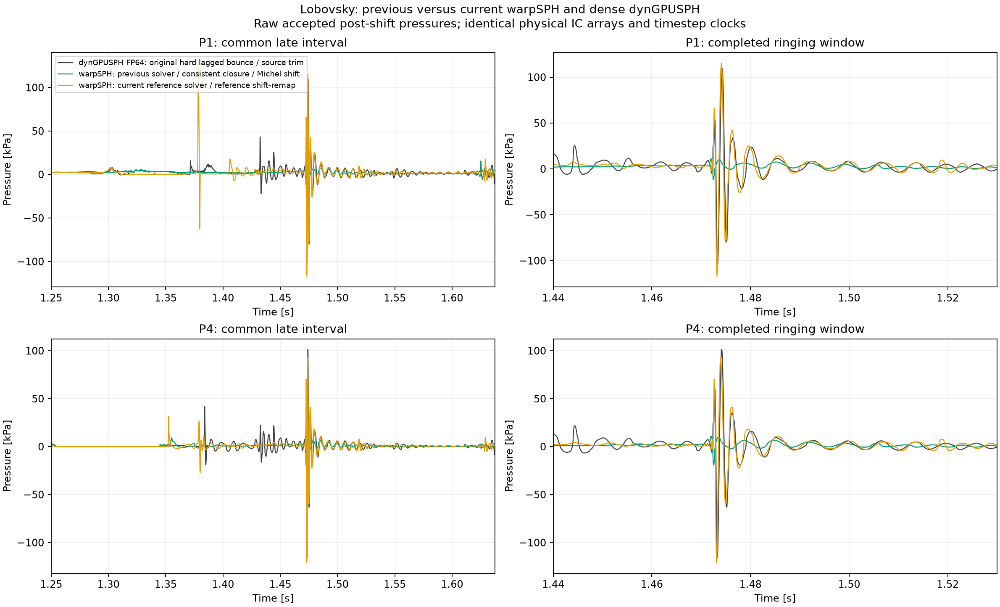
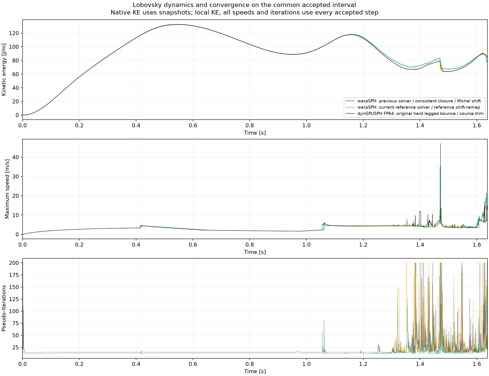

# Lobovsky before/after reference-model changes — 2026-10-29

The recent reference-model port substantially increases late pressure ringing
and convergence work compared with the previous warpSPH consistent-closure
solver. The retained runs establish this directly. Agreement with dynGPUSPH's
own large oscillation does not qualify that change as improved pressure
stability. The latest guard-only repair is a separate change: it leaves the
captured numerical trial bitwise unchanged and changes acceptance checks.

This is an offline comparison of existing trajectories. No physical run,
threshold relaxation, solver-default change or commit was made for this review.

## Matching and cohort

All five FP32 warpSPH recordings have bitwise-identical initial physical
positions, velocities, pressures, densities, particle volumes and boundary
kinds, including all 320,000 fluid particles and 32,176 static wall particles.
The initial mass is unchanged. Ghost placement intentionally differs between
the two older mass-spacing and later volume-spacing configurations. The
closest before/after pair both use volume ghosts, consistent wall velocity,
smooth bounce ramp0.5, support3mm, dx0.75mm, nu0.0001608375 and source startup
history. All use the original native timestep sequence without recalibration.

Every accepted pressure observation and convergence comparison uses exactly
the same first8395 physical steps through1.637500807764885s. The maximum
clock difference is zero for all local runs and dense dynGPUSPH. The current
recording combines the retained accepted prefix with its previously qualified
complete-history restart at6488; no rejected trial is included.

Pressure is the same fluid-only normalized Wendland C2 estimator on accepted
post-shift coordinates at x1.61m, y3/15/30/80mm. The native measurement is its
new every-step accepted-state recording. No sparse10ms pressure, earlier-RK
native probe log, maximum arbitrary particle pressure or interpolation of
mismatched physical clocks is substituted.

| Retained implementation | Full accepted steps | End time [s] | Completion |
| --- | ---: | ---: | --- |
| warpSPH earlier solver, hard bounce, mass ghosts, mixed closure |10000|1.918420|completed|
| warpSPH earlier solver, ramp0.5, mass ghosts, mixed closure |10000|1.918420|completed|
| warpSPH earlier solver, ramp0.5, volume ghosts, mixed closure |10000|1.918420|completed|
| warpSPH previous solver, ramp0.5, volume ghosts, consistent closure, Michel shift |10000|1.918420|completed|
| warpSPH current reference solver, ramp0.5, volume ghosts, reference shift/remap |8395|1.637501|geometric guard stop|
| dynGPUSPH FP64, original hard lagged bounce and source trim |8751|1.700151|completed requested bound|

Earlier local solvers did not have the new geometric certificate. Their full
completion is evidence of operational robustness in this test, but cannot be
treated as proof of the same candidate/stencil guarantee. The current stop
at attempted8396 crosses a sufficient surface-cone bound; the finite rejected
trial has not established actually missing interactions or a physical blow-up.
See [motion investigation](MOTION_GUARD_2026-10-29.md).

## Pressure: substantial increase relative to every older local run

All pressure entries below use the fully covered1.44–1.53s window,724 accepted
samples per run. Ringing RMS subtracts a Gaussian trend with sigma1ms after
uniform0.1ms resampling and excludes3sigma at each edge. Raw peak-to-peak
includes the impact transient and is unfiltered. These are amplitude metrics,
not errors against experiment or a claim of physical accuracy.

| Implementation | P1 raw peak-to-peak [kPa] | P1 detrended RMS [kPa] | Capped solves in this window |
| --- | ---: | ---: | ---: |
| warpSPH hard bounce / mass ghosts |9.069|0.534|724|
| warpSPH ramp0.5 / mass ghosts |8.347|0.778|9|
| warpSPH ramp0.5 / volume ghosts / mixed closure |14.484|1.028|10|
| warpSPH previous consistent closure / Michel shift |22.996|1.222|11|
| warpSPH current reference solver / reference shift-remap |232.297|14.092|48|
| dynGPUSPH FP64 |213.127|13.264|45|

The closest older baseline has P1 minimum/maximum-11.806/+11.189kPa; the
current run has-117.025/+115.272kPa. Peak-to-peak rises10.10x and detrended
RMS11.53x. This is not a previously hidden sampling effect: every local curve
uses all accepted physical steps. P4 peak-to-peak rises30.001→214.046kPa,
7.13x. The old hard-bounce run illustrates why low pressure amplitude alone
cannot qualify a solver: every solve in this window hits its iteration cap.

Over the wider common late interval1.25–1.6375s, P1 peak-to-peak is
27.413→245.031kPa and detrended RMS0.839→7.792kPa (previous→current).
The current run has additional pulses outside the1.474s event, including one
near1.38s, which differ from dynGPUSPH. It is not globally identical to the
reference trace.

The change is also not uniformly worse at every physical time. Over0.4–0.46s,
P1 raw peak-to-peak falls44.972→40.463kPa, versus40.453kPa native. Between
0.65–0.95s the current P1 fast RMS rises0.366→4.732Pa (native4.201Pa), a
large relative factor at a small absolute amplitude. The severe new local
amplification is a late-impact observation.

## Convergence and cost

These local totals use the same8395 accepted steps. Costs sum the recorded
successful solve times, excluding failed trial solves, setup and videos. They
are observed costs on the shared workstation, not a controlled hardware
benchmark. All8395 solves in every local run retain CUDA graphs.

| Local implementation | Mean pseudo-iterations |200-iteration caps| Mean recorded solve [ms/step] |
| --- | ---: | ---: | ---: |
| Earlier hard bounce / mass ghosts |67.480|2324|1717.34|
| Ramp0.5 / mass ghosts |19.196|203|501.32|
| Ramp0.5 / volume ghosts / mixed closure |18.024|131|467.87|
| Previous consistent closure / Michel shift |15.264|28|379.97|
| Current reference solver / reference shift-remap |21.098|84|712.94|

Relative to the previous consistent-closure run, mean iterations increase
38.22%, caps triple, and recorded solve cost increases87.63%. In the common
late interval alone the capped counts are12→67; native has66. In the
1.44–1.53s ringing window the mean iterations are22.515→45.377; native41.345.

The stop conditions also changed. The older generic loop exits on the
position-row/velocity metric alone. The new reference loop checks velocity
and pressure, with source-inspired plateau/trim logic and stable fluid-ID
selection. Of the84 current caps,72 still fail its checked velocity gate and
12 fail only its pressure gate at the cap; all67 late caps fail pressure,
55 also fail checked velocity. These endpoint counts do not tell when the
old algorithm would have exited on the evolving new-model state. They do
show that the additional cap workload is not solely pressure-only failures.
Sixty-five current capped solves use a trimmed metric, so checked and full
residuals must remain distinguished.

The new candidate/operator work and stopping policy are bundled with the
model port. This trajectory comparison cannot attribute the full cost or
convergence change to one formula. The separate guard-only fixed-input
control measured no cost increase; the379.97→712.94ms change compares the
older solver/transport against the entire current reference path.

## Bulk dynamics: closer reference agreement despite noisier pressure

For kinetic-energy averages, each local trace is sampled at the exact native
snapshot clocks, then the same trapezoidal time average is taken. Native KE
is available at approximately10ms cadence, not every accepted step. The
actual late averaging support is1.250186061–1.630120353s; the ringing-window
support is1.440025206–1.520051005s.

| Measurement | Previous consistent closure | Current reference path | dynGPUSPH |
| --- | ---: | ---: | ---: |
| Late mean KE relative to native |+3.794%|+0.108%|reference|
| Ringing-window mean KE relative to native |+5.256%|+0.396%|reference|
| KE at exact local endpoint1.637500808s [J/m] |77.507|85.648|not measured at this exact step|
| Max speed anywhere over common accepted interval [m/s] |35.063|26.073|47.050|
| Max speed at exact common endpoint [m/s] |7.083|15.922|15.732|

The current solver follows the native bulk KE much more closely through the
late impact. Its maximum particle speed over the common interval is lower
than the previous solver's, so these data do not demonstrate a universal
velocity instability or greater global energy growth. The endpoint KE
difference alone(+10.50% versus the older local trajectory) is not evidence
of excess energy relative to native; the impact phases and histories differ.

In1.44–1.53s, P1 pressure-trace RMS difference against dense dynGPUSPH improves
15.202→9.344kPa. Over the broader common late interval it improves only
9.162→8.392kPa. Reference agreement and low pressure amplitude give different
rankings here and must be reported separately.

## What changed, and what can be concluded

The nearest older full trajectory is the consistent-closure run. Compared
with it, the current named compatibility path changes several coupled pieces:

* Generic dual-time RK/point-implicit map becomes the dedicated compiled-source
  map, including first-two warmup clocks and destination/final-weight factors.
* Wall closure ordering, physical/Shepard/mirrored velocity roles, moment
  inversion/lambda and source surface/sensor handling change together.
* Geometry-only Michel shifting becomes the source collision/cohesion shift,
  pressure remap, diagonal velocity remap and source shift-BDF history.
* The stopping policy adds pressure checks and the source plateau/trim logic.
* Accepted-field handoff and static wall geometry are preserved directly,
  avoiding the older derivative roundtrip and COM reconstruction perturbation.
* Candidate lists/frozen-source-cell filtering and explicit coverage checks
  replace the older unguarded neighborhood assumptions.

Both nearest local runs retain FP32, volume ghosts, source-consistent wall
velocity, ramp0.5 bounce, physical ICs/mass and exact native timesteps. The
new path remains explicitly opt-in; generic production defaults are unchanged.
The intermediate old-solver + reference-shift/remap trajectory ends at0.70s,
so it cannot attribute the late increase to shifting alone. New versus old
trajectories establish the combined change, not which individual operator is
responsible.

**Verdict:** the previous consistent-closure path is much quieter, cheaper
and completed this case. The recent full reference port reproduces more of
dynGPUSPH's severe ringing and difficult convergence while improving bulk
reference agreement. Calling it an unqualified stability improvement would be
incorrect. Keep the earlier trajectory as a serious comparison baseline;
retain the current path as explicit reference compatibility, not as evidence
for promoting the shared ringing into the production default. The separate
guard stops still require their own geometric investigation. No further
physical replay or default change was started in this review.

## Evidence and reproduction

Run `scripts/acsph_reference/compare_historical_lobovsky.py --out <fresh-dir>`
with the warp conda Python from the repository root. The final retained output
is `.tmp/acsph-historical-comparison-2026-10-29/with-convergence-audit/`:
`summary.json` includes all six cohorts, every measured window, source/input
hashes, bitwise physical-IC and exact-clock gates, cap residual audit, cost
and native/shared-clock KE measurements. It retains three inspected PNG/SVG
figures. The initial audit-schema failure is preserved separately; it was an
offline missing optional metadata key, and no physical data was changed.

The final analysis took7.11s; it performs zero simulation steps, so physical
ms/step and simulation-video requirements do not apply. The source is reusable
and syntax-checked. A previous8.11s pass generated the same plots before the
additional cap-residual audit. The older/full and current/partial physical
recordings and their original status receipts remain untouched.
