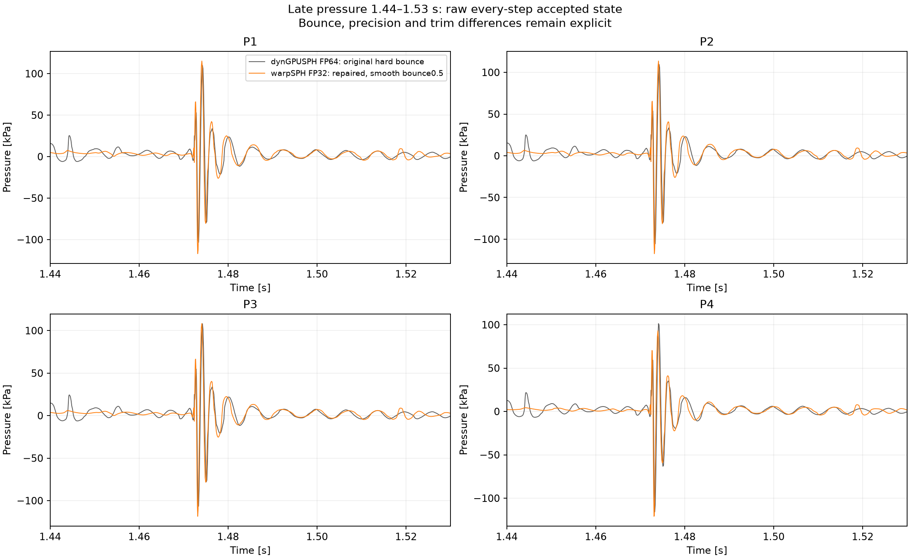

# ACSPH late-run motion-guard failure — 2026-10-29

The warpSPH FP32 stop at attempted step 6489 was a false rejection by its
fixed half-support motion guard. The unchanged solve converges, stays within
all relevant geometric coverage bounds, and produces the same result with
larger candidate lists. This establishes the cause of this stop; it does not
resolve the late pressure ringing or justify a numerical-model default.

The dynGPUSPH FP64 dense reference completed all 8751 steps to
1.700150834901507 s. The original warpSPH run accepted 6488 steps to
1.3519601405568207 s before stopping. Both original trajectories are retained.

## Reproduction and geometry

An unchanged frozen numerical runtime was replayed from the original IC.
A read-only callback immediately before the old guard captured the rejected
trial, its exact solve input, and a complete-history checkpoint before that
step. All 6489 diagnostic rows (including the initial state) match the
original failure exactly; 107 saved snapshots through 1.060 s were also
checked bitwise during replay. Reproduction took 3853.90 s, approximately
594 ms per attempted step, versus 3757.12 s / 579 ms in the original failed
campaign. These wall figures include output and a failed step, rather than
measuring a pure solve kernel.

| Quantity | Captured result |
| --- | ---: |
| Physical support radius R | 3.000 mm |
| Old rejection threshold | 1.500 mm |
| Maximum accepted-iterate displacement | 1.530606 mm = 0.510202 R |
| Maximum evaluated RK displacement | 1.530557 mm |
| Actual candidate cutoff | 8.485281 mm = 2 sqrt(2) R |
| Pair-coverage motion budget | 2.742640 mm |
| Surface-cone stencil budget | 2.250000 mm |
| Cached wall-bounce budget | 3.376390 mm |
| Pseudo-iterations / exit | 53 / full residuals |
| Full epsilonV / epsilonP | -8.007285 / -7.215344 |
| All trial fields finite | yes |

The old code enlarged the search support to 2R, but the CSR construction
additionally multiplies it by `config.verletScale = sqrt(2)`. Its fixed 0.5R
guard ignored this additional coverage. All evaluated RK stages and all
accepted pseudo-iterates satisfy the independent bounds below.

* Pair coverage: if every physical row moves at most D, an active pair at
  distance less than R began within R + 2D. Require R + 2D < actual CSR cutoff.
* Surface cone: its radius is R/4, and the reference uses a one-cell stencil
  of width R. D < 3R/4 guarantees that every cone pair lies in that stencil.
  This is a separate restriction even with a very large pair list.
* Stationary-wall bounce: its contact radius is 1.155 dx. Subtract any fluid
  and wall displacement since the cached bounce list was built, then require
  D + 1.155 dx below its remaining cutoff.

The maximum-motion particle is UID 319765, near the right wall at
(1.6042, 0.0782) m, rather than the fastest group in the previously saved
frame near the left side. It has 40 physical neighbors including itself,
sampling density ratio 0.709, pressure 15.898 kPa and velocity
(2.438, -5.100) m/s in the rejected trial. Position motion also contains the
BDF history and previous external-shift contribution; last accepted speed
times dt alone was insufficient to diagnose this stop.

## Same-input controls and repair qualification

Non-evolving controls replayed the captured solve with search-support factors
2, 3 and 4, with the old guard bypassed only in those diagnostic copies.
No physical step, external shift or trajectory was accepted by the controls.

| Search support factor | Iterations | Max coordinate difference from factor 2 | Max velocity difference | Max pressure difference |
| --- | ---: | ---: | ---: | ---: |
| 2 | 53 | bitwise identical to captured trial | bitwise | bitwise |
| 3 | 53 | 1.1921e-7 m | 9.8348e-6 m/s | 0.01404 Pa |
| 4 | 53 | 1.1921e-7 m | 8.0168e-6 m/s | 0.01257 Pa |

Small nonzero differences with larger lists are consistent with changed
floating-point accumulation order; no larger-list dependence is evident at
these measured scales. Every control passes the pair, cone and bounce bounds.
The controls took 2.31, 3.70 and 6.02 s, including read-only stage inspection.

The production repair keeps the same candidate list and physical equations.
It tracks maximum displacement at every RK evaluation and accepted iterate,
then checks the minimum of the three geometric budgets on each iteration.
The motion read shares the existing convergence synchronization and remains
CUDA graph compatible. Rejected solves cannot overwrite persistent surface
fields. The guard still rejects genuinely uncovered geometry; there is no
automatic threshold tuning, larger-list fallback or removed safety check.

Two independent restart gates passed:

1. Restoring the complete particle state, histories, low position bits,
   adjacency, bodies and scheme history reproduces the old failure bitwise.
2. The repaired solve accepts exactly those same coordinates, velocities,
   pressures, incremental positions, lambdas, normals and edge flags bitwise.
   Its graph is validated again and remains active.

Eighteen focused CPU checks pass, including an intermediate-stage excursion
that returns to a safe endpoint but must still be rejected, geometric
counterexamples, cached-bounce margin, and unchanged tracked/untracked tensor
outputs. A fixed-input GPU timing control with three warm repeats gives
median 1.83386 s for the old isolated solve and 1.82513 s for the repaired
solve (both 53 iterations). No measurable overhead in this small timing
sample; it is not a sustained trajectory performance claim. The physical
one-step restart including setup/video took 6.53 s.

## Continuation and limitations

**Latest status:** the resumed run subsequently stopped at attempted step8396,
after8395 accepted steps through1.637500807764885s. At pseudo-iteration12,
maximum motion2.25043716mm crossed the separate surface-cone certificate
2.25000002mm. This bound is sufficient; crossing it alone does not establish
an actually missing pair. No threshold waiver or further physical restart
has been applied.356 steps remain, and complete checkpoint8300 is retained.
The original continuation took2861.15s for1907 accepted steps plus its failed
attempt (approximately1500ms per accepted step, including output). The
partial accepted trajectory is recovered in `warpsph-f32-partial-8395/`, with
comparison in `late-analysis-partial-8395/` under the investigation root.
The1.44–1.53s comparison window is fully covered; the1.25–1.65s and1.59–1.68s
windows are incomplete. No complete viewer archive or full-analysis claim
was produced. The bounded checkpoint8300 replay then reproduced all96 accepted diagnostic
rows and captured attempted8396 in225.42s. The finite rejected trial at
iteration12 has maxspeed16.066m/s and pressure range-17.590 to55.803kPa.
The accepted same-clock native speed at8395 is15.732m/s versus local15.922.
The exact input/trial and complete checkpoint8395 now reside under
`reproduce-cone-8396/`; further tests can start immediately before the stop.
No physical run is active. Next: inspect actual stage-zero cone/stencil
coverage and source-consistent handling; the sufficient guard was not waived.

The remaining 2263 steps have been launched from the qualified complete
checkpoint at step 6488, with the original native timestep sequence. The
runtime copies the previous frozen source and changes only
`dyngpusphReference.py` plus the new `referenceMotion.py`; concurrent boundary
changes are excluded. Video, streamed progress, velocity/stall/wall
watchdogs and rolling complete checkpoints are enabled. A persistent serial
supervisor merges accepted prefix/suffix data, verifies every clock, builds
the late pressure comparison, and exports a complete viewer trajectory.

The accepted prefix is unchanged and was not replayed with the new all-stage
guard. The suffix is explicitly a complete-history qualified restart, not a
claim of a fresh full run under the new guard. Original failures remain
untouched. The first few continued steps contain pressure ringing and a
200-iteration cap; the guard repair does not remove those model/convergence
questions. Late amplitudes remain unresolved until full coverage is available.

The named comparison remains **warpSPH FP32, smooth fresh-stage ramp0.5
bounce, physical-fluid-ID trim** versus **dynGPUSPH FP64, original hard lagged
bounce, original source trim**. These are not precision-only controls.

## Recovered complete window: 1.44–1.53 s

The partial trajectory covers this window in full:724 accepted samples per
solver, every physical clock matching exactly. Both implementations exhibit
the large pulse near1.474s and the subsequent ringing. This is direct dense
accepted-state data from the completed dynGPUSPH rerun, rather than the old
10ms snapshots.

| P1 metric | dynGPUSPH FP64 | warpSPH FP32 |
| --- | ---: | ---: |
| Raw minimum | -103.316 kPa | -117.025 kPa |
| Raw maximum | 109.811 kPa | 115.272 kPa |
| Raw peak-to-peak | 213.127 kPa | 232.297 kPa |
| Detrended RMS,1ms Gaussian trend | 13.264 kPa | 14.092 kPa |
| Detrended RMS,5ms Gaussian trend | 16.467 kPa | 17.530 kPa |
| Iteration-cap steps,all probes' shared solve | 45 | 48 |

The1ms/5ms detrended RMS is evaluated after excluding3sigma at either edge;
filters are descriptive amplitude measures, not physical accuracy norms.
P1 raw peak-to-peak is about9% higher in warpSPH and detrended RMS about6%
higher. P1 trace-difference RMS is9.344kPa, which also includes phase and shape
differences. The native peak has21 probe contributors. P2/P3 show similar
large pulses; P4 raw peak-to-peak is216.996 versus214.046kPa. These data do not
establish a much larger warpSPH-only ringing amplitude in this completed
window. They also do not establish accuracy against experiment, isolate the
remaining precision/bounce/trim differences, or cover the entire requested
1.25–1.65s/1.59–1.68s windows.

## Artifacts and reproduction

All investigation artifacts are under
`.tmp/acsph-motion-investigation-2026-10-29/`:

* `reproduction/audit.json`, `reproduction/capture/`: exact failure and history.
* `controls/summary.json`, `trial-analysis/`: fixed-solve geometry and fields.
* `restart-old-guard/`, `restart-repaired-one-step/`: bitwise restart gates.
* `guard-benchmark.json`, `repair-tests.log`: timing and tests.
* `repair-source-receipt.json`: source hashes and exactly two-file overlay.
* `continuation-status.json`: live progress, failure or completion receipt.
* `continuation/`: resumed physical states, video and rolling checkpoints.
* `warpsph-f32-complete/`, `late-analysis/`, `warpSPH-lobovsky-complete.h5`:
  generated only when continuation/validation reaches the appropriate phase.

`STOP` in that root cancels only the supervisor's owned descendants. Original
campaign status remains failed; its completed reference is reused. An
unrelated postprocessing variable-shadowing bug was fixed in the campaign
script and its partial analysis recovered without a physical rerun.

The retained entry points are `probe_reference_motion.py`,
`analyze_reference_motion.py`, `probe_reference_motion_case.py`,
`resume_reference_motion.py`, and `finish_reference_motion.py` under
`scripts/acsph_reference/`; each has CLI help and explicit runtime/output
arguments. No commit or numerical default promotion is part of this repair.
