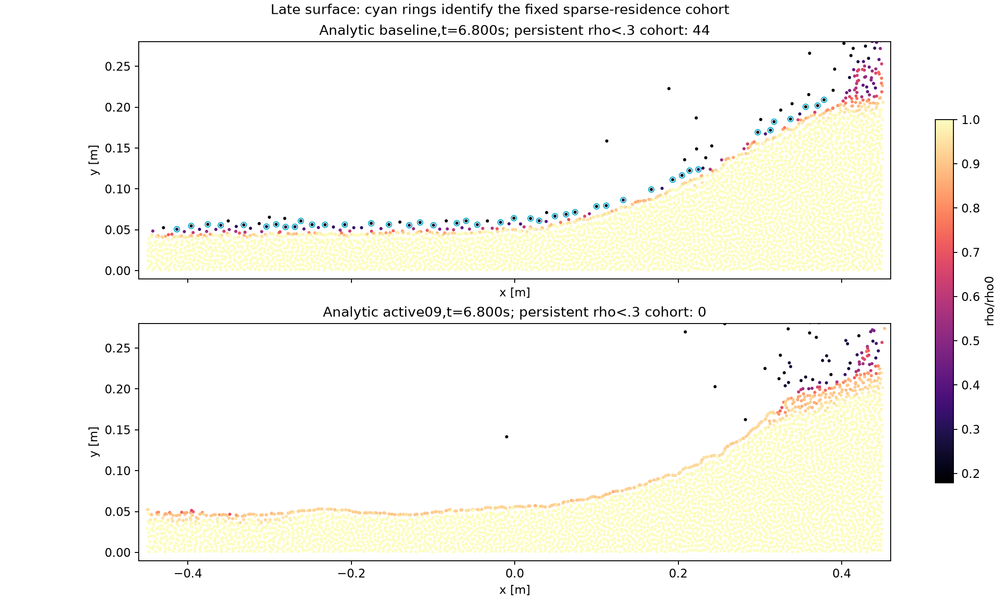
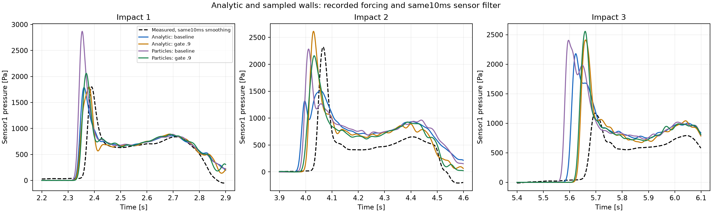

# Sampling recovery in the native incompressible solvers

The native DFSPH family now enables the selected `rho/rho0 >= 0.9` divergence
pressure policy by default. Classic DFSPH, predictor-first DFSPH and VD+PS
share the same projection implementation and boundary operators. IISPH shares
the density/force operators and preparation rules; its density-only constraint
already allows under-sampled fluid to recover without a separate DF gate.

This recovery gate is a local extension, supported by the tank/drop, dam-break
and sloshing experiments. It is distinct from the published DFSPH method and
from the reference weak-factor cutoff. Use an explicit threshold of zero to
reproduce the original divergence constraint.

## Problem and rule

Summation density is also a sampling measure near a free surface. A detached
particle can have density close to its self contribution (about `0.179 rho0`
in the C4/4dx fixtures) while retaining nonzero links to the bulk. Enforcing
non-increasing density there can prevent it from approaching its neighbours:
it rides above the fluid instead of recovering normal sampling. Raising its
pressure can also produce very noisy pressure values on weak links.

For a **clamped divergence solve**, the pressure unknown is active only when

```text
kind == fluid and wall_completed_density / rho0 >= minDivergenceDensityRatio
```

The default threshold is `0.9`; equality remains active. Below it, both the
warm-start unknown and every updated pressure iterate are zero. Disabled rows
do not contribute to the stopping statistic. The source, density, particle
mass and neighbourhood are preserved. Neighbour pressure forces still act
on these particles: there is no asymmetric acceleration or pair-force mask.
Pressure may reactivate after sampling recovers.

Use the full density including sampled or analytic wall support. A normal
bottom layer must not be disabled merely because its fluid-only sum is low.
Physical-stage Dirichlet density conditions are applied before pressure
coefficients and the gate are evaluated in every native DFSPH ordering.

The gate is bypassed by signed divergence solves and by every density solve.
The latter constrains predicted density relative to `rho0`, so under-sampled
particles may compress until they approach the target. Applying the DF gate
to IISPH or to density correction would remove a different constraint.

## Common implementation and distinct integration orders

| Path | Physical sequence | Recovery policy |
|---|---|---|
| Classic DFSPH, `df_np_cd` | DF → nonpressure predictor → density projection → drift | Shared clamped DF gate |
| Predictor-first, `np_df_cd` | Nonpressure predictor → DF → density projection → drift | Same gate |
| VD+PS, `np_df_shift` | Nonpressure predictor → DF → drift → density position correction and velocity resampling | Same DF gate; positional multiplier remains ungated |
| IISPH | Nonpressure predictor → density projection → drift | Density constraint permits sampling recovery |

All DFSPH compositions call `modules.dfsph.solveDFSPHProjection`. IISPH and
DFSPH share rest-volume continuity/force operators, analytic wall gradients,
contact interpolation and exact pressure diagonals. Static sampled and
analytic walls use the same gate semantics. Signed periodic projections
remain unchanged. Legacy `divergenceFree`, `omniIncompressible`,
`dfsphReference` and Band remain explicitly labelled comparison methods;
their historical algorithms are not silently converted into these schemes.

The separate `weakFactorThreshold=1e-5` protection disables inverse factors
with insufficient geometric support before density and timestep scaling.
It applies to both DFSPH constraints and prevents very large pressure on
nearly zero diagonals. It is measured in inverse simulation length squared;
convert it when changing coordinate units. The 0.9 sampling gate is
dimensionless and addresses re-entry rather than diagonal conditioning.

## Configuration and replay

```python
schemeConfig.dfsph.minDivergenceDensityRatio = 0.9  # Native default
schemeConfig.dfsph.ordering = "df_np_cd"            # Or the orders above

# Original ungated/reference policy:
schemeConfig.dfsph.minDivergenceDensityRatio = 0.0
```

Prepared matrix version 9, revision `sampling-recovery-v1`, explicitly sets
the 0.9 gate for all three native DFSPH methods and either wall representation:

```json
{"df_sampling_gate": {"minDivergenceDensityRatio": 0.9,
                      "scope": "clamped divergence only"}}
```

Historical prepared revisions (`original`, `stability-v1`, `consistency-v1`)
explicitly retain zero. Saved pre-gate matrix manifests without this field
also retain zero. Standalone native configurations that omit the field use
the new default; explicitly serialized zero remains zero on round trip.
Existing results are never relabelled or overwritten by generating a new plan.

Native relaxation, stopping bounds and iteration caps are unchanged. The
prepared comparison retains its declared relaxation of 0.25, DF bound of
0.1%, CD bound of 0.01% and cap of 100. A budget termination remains an
unconverged solve, regardless of whether the trajectory finishes.

## Initialization, force and pressure contracts

- Closed and periodic domains keep nominal mass filling the declared volume.
  Apply bounded 0.01dx jitter, relax with damping, check an undamped rest hold,
  then sample the requested velocity field on the prepared positions. Retain
  incomplete preparation as evidence rather than silently changing mass.
  Version 9 records a separate canonical preparation gate of 0.9 for every
  method, including IISPH and ungated evolution controls, so the first method
  requesting a fixture cannot select a different relaxation policy.
- Free surfaces use one bulk mass calibration. Fit touched flat analytic
  faces to the calibrated lattice, preserving the fluid configuration. Share
  the fixture across methods; do not recalibrate it per solver or ordering.
- Preserve the case viscosity. Sampled free-slip viscosity uses fresh
  reflected boundary references without changing pressure boundary state.
  Analytic walls use the existing solid-integral coupling. Known wall gravity
  contributes once to the physical predictor/correction, never to the
  auxiliary position projection.
- Warm-start histories carry physical `p_density * dt²` and `p_DF * dt`.
  Encode the same physical initial pressure using the actual first timestep.
  Coupled methods seed density pressure; VD+PS seeds physical DF pressure and
  leaves its auxiliary positional multiplier zero. Keep auxiliary shift
  pressure separate from reported physical pressure. Preserve histories
  through checkpoints, particle reconstruction and boundary updates.

## Evidence and remaining tradeoffs

The selected gate removes the persistent surface layer in both wall models.
In the analytic 7 s sloshing A/B, 4,200 fluid particles, calibrated mass,
fitted walls, GPU FP32, C4/4dx, viscosity `1e-6` and a 0.2 ms timestep ceiling
are shared exactly between the two arms.

| Analytic sloshing | Ungated | Gate 0.9 |
|---|---:|---:|
| Persistent near-self / rho<0.3 / rho<0.5 cohorts | 6 / 44 / 64 | 0 / 0 / 0 |
| Integrated kinetic energy per mass | 0.725202 | 0.722891 |
| Filtered impact peaks [kPa] | 1.789 / 1.509 / 2.178 | 1.801 / 2.614 / 2.410 |
| Full pressure-trace relative L2 error [%] | 74.45 | 71.65 |
| Final paired fraction [%] | 5.77 | 8.09 |
| Wall milliseconds per step | 22.77 | 22.96 |

Persistent cohorts must stay below the named sampling bound for at least
80% of saved samples after 6.2 s and near the interior bulk for at least 50%.
Near-self means less than 2% recovery from self density to the target. Sparse
spray remains; zero persistent cohorts does not mean every particle has bulk
density. See the committed [metric summary](sampling_recovery_2026-10-26/summary.json).



Pressure curves use the same 10 ms Gaussian filter without time alignment.
Measured peaks are 1.800 / 2.322 / 1.171 kPa. First and third phase improve in
this realization, second phase worsens, and the third amplitude remains too
large. Pairing and transient wall crossings worsen. Sensor ringing and raw
pressure transients remain even though sparse-particle DF pressure noise drops.
The preserved analytic lattice also has a startup density defect and transient;
it was not silently relaxed for this comparison.



The adopted policy is a common implementation baseline, not a claim of equal
accuracy for the integration orders. Full-flow recovery evidence is strongest
for classic DFSPH. VD+PS retains its documented tight-convergence cost for
accurate hydrostatic pressure. Pressure convergence, resolution sensitivity,
packing and containment remain qualification topics. One chaotic realization
does not establish a statistical ranking.

Detailed local records, source archives, audits and videos remain under
`.tmp/dfsph-analytic-sloshing-2026-10-26`,
`.tmp/dfsph-remedy-sloshing-2026-10-26`,
`.tmp/dfsph-reentry-2026-10-26` and
`.tmp/dfsph-pressure-convergence-2026-10-26`. They are generated evidence,
excluded from Git; the figures and summary above are the curated record.
