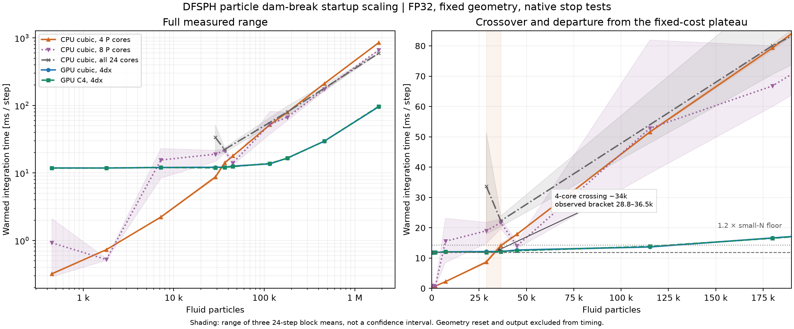

# Particle-wall DFSPH startup scaling — 26 October 2026

The requested curves **do intersect**. The stable four-P-core SPlisHSPlasH
reference crosses current GPU DFSPH between **28,800 and 36,450 fluid particles**;
local linear interpolation gives approximately **34,000**. The measured block
ranges are separated on each side of this bracket. This is an observed bracket,
not an extrapolation from smaller cases.

The GPU has a **roughly 12 ms fixed-cost floor** through 28,800 fluid particles.
It rises gradually thereafter: 13.7 ms at 115,200, 16.6 ms at 180,000, 29.6 ms
at 460,800 and 95.9 ms at 1,843,200. Defining a reproducible departure criterion
as **20% above the small-size floor** brackets that departure between
**115,200 and 180,000** fluid particles. This criterion describes the curve;
it is not a sharp hardware transition.

At the largest size, CPU costs are **851.5 / 662.8 / 594.1 ms** with four/eight/all
24 cores. GPU is **6.2× faster than the measured full-CPU configuration** there.
The C4 GPU overlay closely follows the common cubic-kernel curve. Every one of
3,168 timed integrations uses **DF1 / CD2**, with native stopping tolerances and
no pressure-solve cap. Iteration growth does not explain these scaling curves.



Lines show mean step times; shading spans the three block means, not a
confidence interval. The eight-core and full-CPU curves have appreciable
small/intermediate-size variability. In particular, the eight-core mean crosses
the GPU curve earlier because that CPU configuration becomes slower/noisier;
this is not the useful crossover of the fastest tested CPU settings near the
four-core bracket. Four cores are the fastest tested CPU choice at both ends of
that bracket. The four all-core controls are already slower than GPU; no
all-core crossing is inferred below their measured range.

| Fluid particles | GPU cubic [ms] | GPU C4 [ms] | CPU 4P [ms] | CPU 8P [ms] | CPU all 24 [ms] |
|---:|---:|---:|---:|---:|---:|
| 450 | 11.90 | 11.81 | 0.32 | 0.92 | — |
| 1,800 | 11.85 | 11.84 | 0.73 | 0.52 | — |
| 7,200 | 12.06 | 12.07 | 2.22 | 15.55 | — |
| 28,800 | 12.16 | 11.93 | 8.68 | 18.99 | 33.69 |
| 36,450 | 12.17 | 12.12 | 14.09 | 21.69 | 22.28 |
| 45,000 | 12.66 | 12.44 | 17.87 | 14.02 | — |
| 115,200 | 13.66 | 13.84 | 51.58 | 52.79 | — |
| 180,000 | 16.64 | 16.54 | 79.34 | 66.79 | 80.06 |
| 460,800 | 29.58 | 29.56 | 210.64 | 174.05 | — |
| 1,843,200 | 95.87 | 97.09 | 851.55 | 662.80 | 594.10 |

## What was measured

A simple 2D tank is 3.2×1 m, with a 1.2×0.6 m column on the left, six sampled
wall layers, zero fluid velocity and zero initial pressure. Flat wall planes
are halfway between the first fluid and wall samples. Both implementations read
the same saved FP32 fluid/wall coordinates. The common comparison uses cubic
kernels with support 4dx, rest density 1, gravity 9.81, viscosity 0.01 and the same
initial mass/volume. A one-time analytical square-lattice normalization is
applied separately for each kernel. The C4 GPU overlay uses that kernel's own
normalization. Native effective volume is checked against physical mass/rest
density to relative error <3e-7.

Local uses current classic DFSPH with the selected 0.9rho0 gate, contact-Shepard
sampled-wall pressure, reflected sampled-wall viscosity and normal ghost rows.
Native uses Akinci2012 sampled walls/self pressure and standard fluid viscosity
with zero boundary viscosity. Local/native relaxation remains 0.25/0.5; both use
DF0.1% / CD0.01%, caps100, minimum DF1/CD2. These are their actual implementation
paths; pressure/viscosity wall operators are not identical. No equation or
boundary implementation is changed to achieve the crossing.

Each worker warms 12 steps, then measures three blocks of 24 steps. Before each
integration, positions, velocities, pressure histories and applicable local
state are restored to the initial state **outside the timer**. Native rest
coordinates/zero velocity/zero pressure carriers are checked before sampled
steps. Fluid/wall geometry is checked against the shared fixture on both
backends. Normal valid main-neighbour-list reuse remains enabled locally;
SPlisHSPlasH performs its usual search each step. Contact support is rebuilt by
the unchanged local implementation. The initial expensive search/compilation
is excluded by warmup.

The shared step is `min(1e-4*sqrt(dx/0.01), dx²)` seconds, deliberately below the
viscosity constraints so both see the same requested dt. A sample is one
repeated startup integration, not a progressing dam break. Maximum observed
single-step displacement stays below 0.001dx. This measures **compute ms/step**,
not time per simulated second or accuracy/dissipation in developed flow. The
largest FP32 states have small density-roundoff pressure impulses amplified by
the tiny dt; these are monitored, not interpreted as physical motion. No
long-time simulation claim follows from these timings.

Local timing is the normal projected integrator **including its finalization**,
using CUDA events with synchronization at the interval's end. Native timing
covers `timeStepNoGUI()` including step, boundary simulator and 2D closeout.
Reset, progress, fixture generation, package startup, output and instrumentation
are excluded from compute cost. They are reflected separately in the saved
worker/runner wall receipts. No video is recorded for these repeated frozen
microbenchmarks. GPU workers run sequentially, with finite/velocity/motion and
solver-cap guards. Repeated-time stall detection is intentionally disabled.

Hardware: NVIDIA RTX PRO 6000 Blackwell; Intel Core Ultra 9 285K, 8P+16E cores,
no SMT. CPU OpenMP threads are bound to P cores0–7 for the four/eight-thread
curves, and cores0–23 for the full-chip control. Thread counts/affinity are
explicit, clocks are not locked and the desktop is shared. CPU timing
variability is retained; these are not universal crossover counts or a claim
that all CPU tuning possibilities were exhausted.

## Where the large-size slope comes from

The fixed floor includes host dispatch, small kernel launches, synchronization
and fixed integration/solver bookkeeping, as diagnosed in the earlier
[call audit](PERFORMANCE_2026-10-26.md). This sweep isolates that floor from
particle-count growth; it does not assign every millisecond to launch latency.

The local main Verlet padding is **sqrt(2)**. At 1.84 million fluid particles it
contains **199.3 million candidate entries across 2,004,768 total rows**, with
about **100 candidates per fluid row**. Native has roughly **48 true fluid
neighbours per bulk query** at the same 4dx support. The extra local entries
include padding and ghost samples; many contribute zero to a pressure operator
but still incur traversal/field-load work. Physical wall samples are shared;
local ghost rows are additional. At the four-core crossing bracket, local total
particle counts including walls/ghosts are 49,248–59,418.

A descriptive affine fit over N>=115,200 gives approximately **48 ns per added
fluid particle** for GPU and **464 ns** for the four-core CPU curve. This is a
large-size trend, not a decomposition of fixed overhead and not the model used
to claim a crossover. GPU peak Torch allocation at the largest common-kernel
point is approximately **4.44 GB**. Detailed candidate counts, native sampled
neighbour counts, time blocks and wall costs are in the receipts.

The immediate optimization target for the existing small tank/matrix cases is
therefore the **roughly 12 ms floor**: shared pressure/contact geometry, fewer
small operations/round trips and per-step reuse of gradient weights. Larger
cases additionally benefit from reducing redundant padded-neighbour traversal.
Boundary-code changes remain outside this work.

## Reproduction and evidence

[Benchmark CLI](../../scripts/bench_dfsphScaling.py) writes an immutable numerical
plan/shared geometry, executes workers and rebuilds the report. Run from the
repo root in the `warp` environment, with `PYTHONPATH=src`:

```sh
python scripts/bench_dfsphScaling.py plan --root .tmp/new-scaling --threads 4 8
python scripts/bench_dfsphScaling.py run --root .tmp/new-scaling
python scripts/bench_dfsphScaling.py extend --root .tmp/new-scaling --nx 225 250 500
python scripts/bench_dfsphScaling.py run --root .tmp/new-scaling --nx 225 250 500
python scripts/bench_dfsphScaling.py run --root .tmp/new-scaling --nx 200 225 500 1600 --threads 24
python scripts/bench_dfsphScaling.py report --root .tmp/new-scaling
```

A frozen copy of the boundary package is loaded from each plan's `deps/`:
**116 Python source fingerprints were verified unchanged throughout**. The
live boundaries repository was not edited. Native Release/FP32 AVX build is
`eccce86155776f6ac52d5080b1f720a52bf29450`, with performance precomputation enabled;
the binding binary fingerprint is in each native initial-state audit.

There are **44 successful workers at 10 resolutions**, 44 matching-IC audits,
3,168 timed integrations plus 528 warmup integrations. Every worker completes
without a cap or velocity/motion alarm. The first native setup loaded zero walls
because its loader prepends the scene directory to an absolute particle-file
path; it stopped before integration. That setup/log is retained under
`failures/`, and the path was corrected to scene-relative before valid CPU data.
No production solver path was edited.

[Portable summary and initial-state audits](startup_scaling_2026-10-26/summary.json),
[raw timing table](startup_scaling_2026-10-26/timings.csv).
Full fixtures, logs, frozen dependency and failure receipts remain in
`.tmp/dfsph-startup-scaling-2026-10-26` (`KEEP` present).
